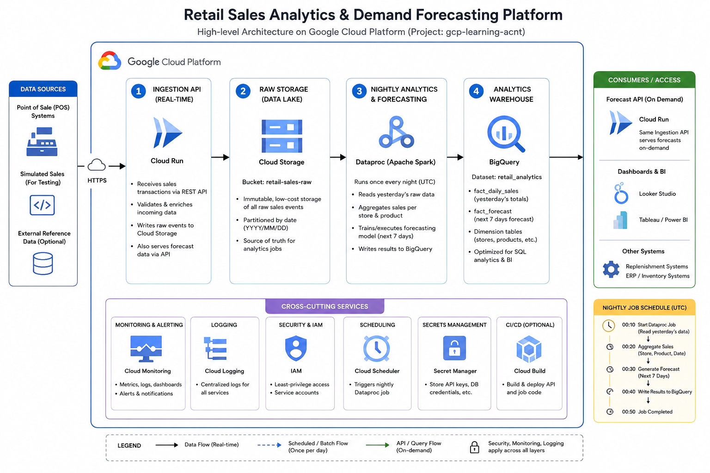

# Retail Sales Analytics & Demand Forecasting Platform

A cloud-based system that watches a retail chain's sales as they happen, and every night automatically predicts how much of each product each store will sell over the coming week — so managers can stock the right amount and avoid both empty shelves and wasted inventory.

Built end-to-end on Google Cloud Platform (project `gcp-learning-acnt`).

---

## Table of Contents

1. [The Business Problem](#the-business-problem)
2. [How It Works — The Big Picture](#how-it-works--the-big-picture)
3. [A Day in the Life of the Platform](#a-day-in-the-life-of-the-platform)
4. [The Components, One by One](#the-components-one-by-one)
5. [Where Data Lives](#where-data-lives)
6. [Technology Choices, and Why](#technology-choices-and-why)
7. [Repository Layout](#repository-layout)
8. [Deploying This Yourself](#deploying-this-yourself)
9. [Current Status](#current-status)
10. [Glossary](#glossary)

---

## The Business Problem

Picture a retail chain with around 200 stores. Every day, thousands of small sales happen — a customer buys milk here, batteries there, a jacket somewhere else. Multiply that across every store and every product, and you get a flood of information that's easy to collect but hard to *use*.

Two things go wrong without a system like this:

- **Stockouts** — a popular item runs out because nobody predicted the surge in demand, so the store loses sales and disappoints customers.
- **Overstock** — a store orders too much of something that doesn't sell, tying up money and shelf space in inventory that just sits there.

The fix is **demand forecasting**: looking at how a product has been selling recently and predicting how much of it will sell over the next week, for every product in every store. That's exactly what this platform does, automatically, every single night, without anyone having to run a spreadsheet or ask a data analyst.

---

## How It Works — The Big Picture

At the highest level, there are three moving parts:

```
   Sales happen              Overnight, the computer            Store managers
   throughout the day   -->  "sleeps on it" and works      -->  check tomorrow's
   (or are simulated)        out what's coming next             forecast whenever
                                                                 they like
```

In more technical terms, every sale flows through a pipeline that looks like this:



Reading the diagram left to right:

- **① Ingestion API** — sales come in and are received in real time.
- **② Raw storage** — every sale lands in cloud storage, unmodified, as the source of truth.
- **③ Nightly analytics & forecasting** — once a day, the sales are crunched and next week is forecast.
- **④ Analytics warehouse** — the results are stored here, and the same Ingestion API reads from it whenever someone asks for a forecast.

The panel on the right shows who actually consumes that forecast (the API on demand, and — in the future — dashboards or other business systems). The panel across the bottom lists the shared, cross-cutting services (security, logging, monitoring, scheduling) that every stage relies on.

Everything after "a sale happens" runs on its own, on a schedule, with no human involvement. A store manager (or, eventually, a dashboard) just asks the API a question — *"how much of this product will Store 12 sell next week?"* — and gets an instant answer, computed the night before.

---

## A Day in the Life of the Platform

The easiest way to understand the system is to follow one 24-hour cycle from start to finish, in the order things actually happen. Every time is in **UTC** (the platform's internal clock; store managers in different time zones just see the same forecast whenever they check).

### 🕐 1:00 AM — Yesterday's sales get recorded

A scheduled job (`pos-generator`) wakes up and generates a realistic day of sales transactions for every store — one transaction at a time, exactly like a real point-of-sale system would produce, except compressed into a few minutes since this is a demo environment rather than 200 real stores.

> **Why "yesterday" and not "today"?** Because the store day isn't over yet at 1 AM — a real shop doesn't have its *full* day of sales recorded until the day has actually finished. So this step reports on the day that just ended, which by this point is complete and ready to be analyzed.

Each transaction is sent to the **Ingestion API**, which:
1. Checks the transaction looks sane (positive quantity, positive price, etc.)
2. Saves it as a small file in a "landing zone" in cloud storage — think of this as a filing cabinet with one drawer per day and one folder per store inside each drawer.
3. Also announces it on an internal notification channel (currently unused downstream, but there for future real-time features).

By the time this step finishes, every sale from the day before is safely filed away, ready to be analyzed.

### 🕐 3:00 AM — The nightly analysis runs

Two hours later, once yesterday's sales are guaranteed to be fully filed, the main nightly job kicks off. This is the heart of the platform, and it does three things:

1. **Spins up a temporary computer cluster.** Rather than keeping an expensive analysis server running 24/7 for a job that only takes a few minutes, the platform creates a brand-new cluster of virtual machines just for tonight's job, and destroys it again the moment the job finishes. This keeps the ongoing cost close to zero.

2. **Crunches yesterday's numbers.** It reads every sale recorded yesterday, cleans up anything that looks like a duplicate or an error, and adds up how much of each product each store sold. It also works out useful trends — like the 7-day and 30-day rolling average, and how sales compare to a year ago.

3. **Predicts the next 7 days.** Using that freshly-updated sales history, it trains a simple statistical model (linear regression) that looks at recent sales patterns and day-of-the-week effects, and produces a demand forecast for every store/product combination, one prediction per day for the coming week.

4. **Cleans up after itself.** The temporary cluster is deleted immediately once the job is done — success or failure — so nothing is ever left running (and costing money) overnight.

All of the results — yesterday's totals *and* next week's predictions — are written into a central analytics warehouse.

### 🕐 Any time — Someone checks the forecast

Whenever a store manager (or any other system) wants to know "what should I expect to sell next week," they simply ask the same Ingestion API a question, and it looks up the answer instantly from last night's analysis. No waiting, no re-computing — the heavy lifting already happened while everyone was asleep.

---

## The Components, One by One

### 1. The Data Generator (`pos-generator`)
*A stand-in for a real point-of-sale system.*

Since this is a portfolio/demo project rather than a live retail chain, there's no real cash register sending us transactions. Instead, a small Python program creates believable-looking sales data — the right number of stores, a realistic product catalog, seasonal patterns (a beverage sells more in summer, winter coats sell more in winter), and normal day-to-day randomness — and sends it to the Ingestion API exactly the way a real store's system would. It runs automatically every night at 1 AM UTC.

### 2. The Ingestion API (`ingestion-api`)
*The front door of the whole system.*

A small web service (built with Java and Spring Boot) that does two jobs:
- **Receiving sales** (`POST /transactions`) — validates each one and files it away in cloud storage.
- **Answering questions** (`GET /forecasts`, `GET /sales/daily`) — looks up last night's analysis and hands back the answer.

It runs on **Cloud Run**, a service that automatically starts up when a request comes in and shuts back down when it's quiet — so there's no cost when nobody's asking anything.

### 3. The Landing Zone
*The filing cabinet.*

A cloud storage bucket where every raw sales transaction gets saved as a small file, organized by date and by store. This is the *source of truth* that the nightly analysis reads from — nothing is ever silently thrown away.

### 4. The Nightly ETL & Forecasting Job (`etl-spark-job`)
*The analyst who works overnight.*

A data-processing program (written using Apache Spark, a tool built for crunching large amounts of data quickly across many machines at once) that does the aggregation and forecasting described above. It's designed to run just once a night, on a temporary cluster that exists only for the few minutes the job takes.

### 5. The Analytics Warehouse (BigQuery)
*The central filing system for finished results.*

A cloud database purpose-built for fast analytical queries over large amounts of data. It holds four tables:
- **Store list** and **product catalog** — reference information.
- **Daily sales totals** — one row per store/product/day, with trends baked in.
- **Forecasts** — one row per store/product/future-day, with the predicted quantity.

### 6. The Orchestrator (Cloud Workflows + Cloud Scheduler)
*The night manager who makes sure everything happens on time, in the right order, and cleans up afterward.*

Two small pieces work together here:
- **Cloud Scheduler** is simply an alarm clock — it goes off at 1 AM and 3 AM every day.
- **Cloud Workflows** is the recipe that gets triggered when the 3 AM alarm rings: create a temporary cluster, run the analysis job, wait for it to finish, delete the cluster, and double-check the results landed correctly — and to do that reliably even if something occasionally goes wrong (like temporary unavailability of the specific computer resources requested), it's willing to try a few different options before giving up.

### 7. Infrastructure Setup Scripts (`infra/`)
*The one-time "build the building" step.*

A set of scripts that create everything the platform needs on Google Cloud — storage buckets, the analytics database, permissions, etc. — so the whole thing can be reliably rebuilt from scratch if needed.

---

## Where Data Lives

| BigQuery table | What it holds | Analogy |
|---|---|---|
| `dim_store` | The list of stores (ID, name, region, city) | The store directory |
| `dim_sku` | The product catalog (ID, name, category, cost) | The product catalog |
| `daily_sales` | One row per store + product + day, with totals and trends | Yesterday's cash register tape, totaled up |
| `sku_forecasts` | One row per store + product + future day, with the predicted quantity | Next week's order guide |

---

## Technology Choices, and Why

| Technology | Role | Why this one |
|---|---|---|
| **Java + Spring Boot** | The Ingestion API | A mature, reliable way to build a small, well-tested web service |
| **Cloud Run** | Hosts the Ingestion API | Scales to zero when idle — no cost for a service that isn't constantly busy |
| **Cloud Storage (GCS)** | The landing zone for raw sales data | Cheap, durable, effectively unlimited storage for raw files |
| **Pub/Sub** | Internal "sale just happened" announcements | Decouples the API from anything that might want to react to sales in real time later, without committing to build that today |
| **Apache Spark on Dataproc** | The nightly heavy-lifting analysis | Built specifically for processing large datasets quickly by spreading the work across many machines at once; Dataproc lets that cluster of machines exist only for the few minutes it's needed |
| **BigQuery** | The analytics warehouse | A cloud database designed for exactly this kind of "add up millions of rows and answer a question fast" workload |
| **Cloud Workflows + Cloud Scheduler** | Nightly orchestration | Lightweight, pay-per-use automation — no server has to run 24/7 just to press "go" once or twice a night |

---

## Repository Layout

```
RetailSalesForecasting/
├── data-generator/       Synthetic sales generator (also runs as a nightly Cloud Run Job)
├── ingestion-api/        The Spring Boot API (deployed to Cloud Run)
├── etl-spark-job/        The nightly Spark analysis + forecasting job (runs on Dataproc)
├── orchestration/        The nightly automation recipe (Cloud Workflows) + its alarm clock (Cloud Scheduler)
├── infra/                One-time setup scripts for all the underlying cloud resources
└── retail-sales-analytics-platform.md   The original architecture brief this project is based on
```

---

## Deploying This Yourself

This section assumes some familiarity with the command line and Google Cloud (`gcloud`) — it's the "how," for anyone who wants to actually stand this up themselves, as opposed to just understanding what it does.

**1. Provision the underlying cloud resources** (buckets, database, service accounts, permissions):

```bash
export PROJECT_ID=gcp-learning-acnt
export REGION=us-central1
cd infra/scripts
bash 00_enable_apis.sh
bash 01_create_service_accounts.sh
bash 02_create_storage.sh
bash 03_create_pubsub.sh
bash 04_create_bigquery.sh
bash 05_create_artifact_registry.sh
```

Every script is idempotent — safe to run again if something needs to be re-created.

**2. Build and deploy the Ingestion API** to Cloud Run (see `ingestion-api/Dockerfile`).

**3. Build the Spark job** and upload it to the staging bucket (see `etl-spark-job/pom.xml`; the jar is built via `mvn clean package`).

**4. Deploy the orchestration** — the nightly recipe and its alarm clocks:

```bash
cd orchestration
export PROJECT_ID=gcp-learning-acnt
export REGION=us-central1
bash 00_create_orchestration_sa.sh
bash 01_deploy_workflow.sh
bash 02_create_scheduler_job.sh
```

**5. Deploy the data generator** as a scheduled Cloud Run Job:

```bash
cd data-generator
export PROJECT_ID=gcp-learning-acnt
export REGION=us-central1
bash 01_create_service_account.sh
bash 02_build_and_deploy_job.sh
bash 03_create_scheduler_trigger.sh
```

From that point on, the platform runs itself every night.

---

## Current Status

| Milestone | Status |
|---|---|
| Infra provisioning scripts | ✅ Done |
| Synthetic data generator | ✅ Done, running nightly as a scheduled Cloud Run Job |
| Ingestion API (Cloud Run) | ✅ Done, live and serving |
| Nightly Spark ETL + forecast job | ✅ Done, verified with real end-to-end runs |
| Nightly orchestration (Workflows + Scheduler) | ✅ Done, running automatically every night |
| React dashboard for store managers | ⏳ Not yet built — currently forecasts are retrieved via the API directly |

---

## Glossary

Plain-English definitions for the technical terms used above, for anyone without a cloud/engineering background.

- **API (Application Programming Interface):** a way for one piece of software to ask another piece of software to do something or hand back information — here, the "front door" that receives sales and answers forecast questions.
- **Cloud Run:** a Google Cloud service that runs a small program on demand, automatically scaling up when it's busy and down to nothing (and no cost) when it's idle.
- **Cloud Storage / bucket:** Google Cloud's file storage — like a hard drive in the cloud, organized into "buckets" and folders.
- **BigQuery:** Google Cloud's analytics database, built to quickly answer questions over very large amounts of data.
- **Apache Spark:** a tool for processing large amounts of data by splitting the work across many computers at once, so a job that would take hours on one machine takes minutes across many.
- **Dataproc:** the Google Cloud service that provides the temporary cluster of machines Spark runs on.
- **Pub/Sub:** a messaging system where one part of a system can "announce" something happened, and other parts can optionally "listen" for those announcements, without the announcer needing to know who (if anyone) is listening.
- **Cloud Workflows:** a way to define a multi-step automated process ("do this, then this, then this, and clean up no matter what") without needing a server running to manage it.
- **Cloud Scheduler:** a simple, reliable alarm clock in the cloud that triggers something at a set time every day.
- **ETL (Extract, Transform, Load):** the standard term for "read raw data, clean and summarize it, save the results somewhere useful" — exactly what the nightly job does.
- **Service account:** an identity (like a user account, but for a piece of software rather than a person) used to control exactly what each part of the system is allowed to access.
- **Forecast / demand forecasting:** predicting how much of something will be needed in the future, based on how it's been used or sold recently.
